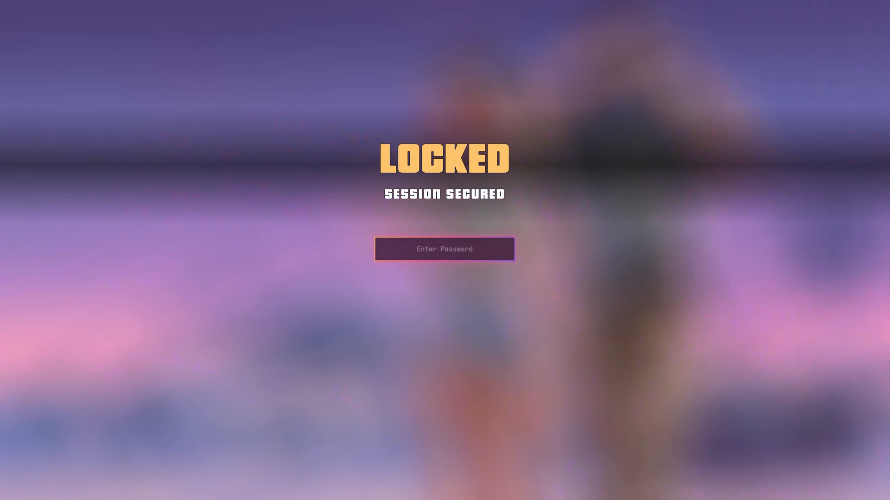
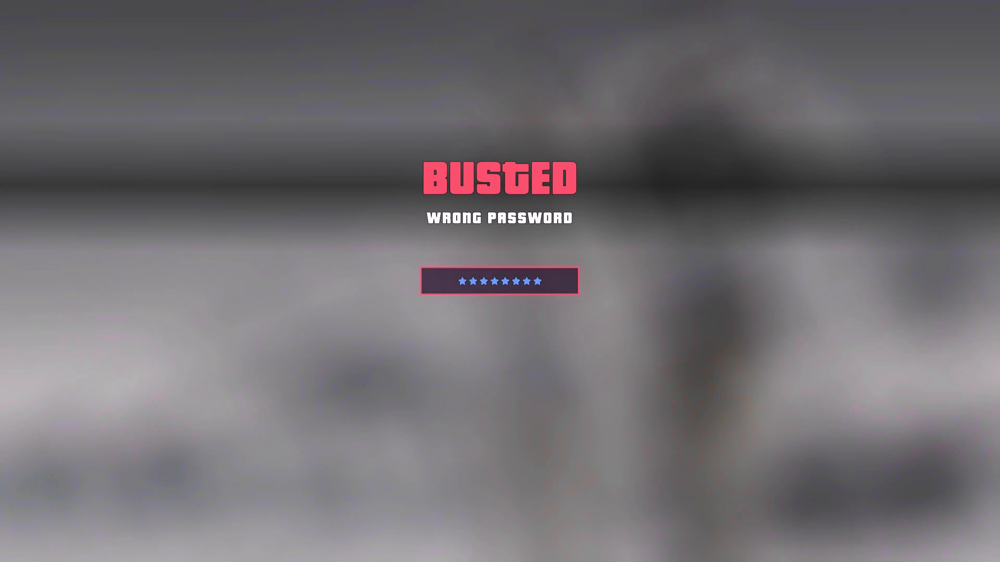
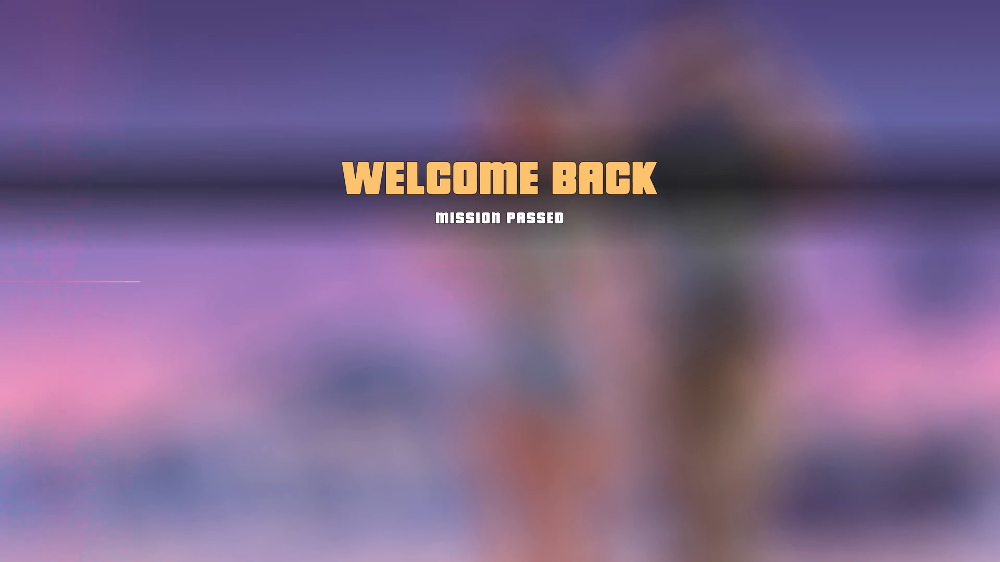

# GTA 6 Lock

Omarchy's lock screen, dressed up for the GTA VI theme. A drop-in replacement for the built-in `omarchy.lock` plugin.


<sub>Lock → wrong password → unlock, recorded with `omarchy-shell lock demo`. Full-quality MP4 on the [v1.0.0 release](https://github.com/dbohry/omarchy-gta6-lock/releases/tag/v1.0.0).</sub>

| Lock | Wrong password | Unlock |
|---|---|---|
|  |  |  |

- **Neon sweep:** on lock, the wallpaper settles in from a zoom as the blur comes up, a pink-to-purple band sweeps across, and the password field rises in with a glow.
- **Mission cards:** a `LOCKED` card slams in on lock and `WELCOME BACK / MISSION PASSED` on unlock, set in Pricedown like GTA's own titles.
- **Wanted stars:** each typed character is a wanted star that pops in, instead of a dot.
- **Busted:** a wrong password turns the wallpaper grey, flashes the stars police red and blue, and slams in a red `BUSTED` card.

The effects only run while the current theme is `gta-vi`. On every other theme it locks and unlocks exactly like the stock plugin.

## Install

```bash
omarchy plugin add https://github.com/dbohry/omarchy-gta6-lock.git --enable
omarchy plugin disable omarchy.lock
omarchy restart shell
```

Disable the built-in lock so only one lock service runs. The restart makes sure `omarchy-shell lock ...` calls reach this plugin.

### Font

The mission cards use [Pricedown](https://www.dafont.com/pricedown.font) by Typodermic, which is free for personal use but not bundled here. Install it for your user and restart the shell so it is picked up:

```bash
mkdir -p ~/.local/share/fonts
cd "$(mktemp -d)"
curl -fsSL -o pricedown.zip "https://dl.dafont.com/dl/?f=pricedown"
unzip -o pricedown.zip "Pricedown Bl.otf"
install -m644 "Pricedown Bl.otf" ~/.local/share/fonts/PricedownBl.otf
fc-cache -f ~/.local/share/fonts
omarchy restart shell
```

Without it, the cards fall back to the default font.

## Try it

```bash
omarchy-shell lock preview   # the lock screen with its intro, click to close
omarchy-shell lock demo      # lock -> wrong password -> unlock, on the preview overlay
```

`demo` plays the whole sequence with simulated typing. It never locks the session or checks a password, which makes it handy for screen recordings.

## Security

Authentication is unchanged from `omarchy.lock`: the same PAM services, fingerprint flow and session lock. After a successful authentication the session stays locked, with input off, for about a second while the unlock animation plays, and is then released.

This is a fork of a built-in plugin, so it does not get Omarchy's later lock screen fixes on its own. To go back to stock:

```bash
omarchy plugin enable omarchy.lock
omarchy plugin remove gta6-lock
omarchy restart shell
```

## License

MIT. Based on the `omarchy.lock` plugin from [Omarchy](https://github.com/basecamp/omarchy), which is also MIT licensed.
